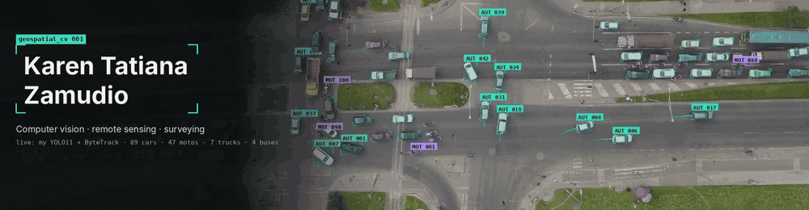

I train models to read the ground from above, and I'm a surveyor, so I know what the ground actually measures. Drone video, Sentinel-2 and GNSS points go in; counts, maps and decisions come out.

```text
$ python detect.py --source ./karen --conf 0.5

class                  evidence
───────────────────────────────────────────────────────────────────────────
computer_vision        YOLO11 detection · segmentation · multi-object tracking
remote_sensing         Google Earth Engine · Sentinel-2 · Dynamic World
geospatial_data        ArcGIS Pro/Online · QGIS · geopandas · DuckDB · 8M-row ETL
surveying_engineer     COPNIA license · GNSS-RTK · MAGNA-SIRGAS (EPSG:9377)
uas_pilot              Aerocivil certified · DJI Matrice 4E · photogrammetry

5 detections · M.Sc. Artificial Intelligence, Universidad de Buenos Aires
```

### Tracked projects

| ID | Project | Input → Output | Result |
| :-: | :-- | :-- | :-- |
| `#01` | [**aforos-vehiculares-yolo**](https://github.com/Kzamudioq/aforos-vehiculares-yolo) | drone video → tracked vehicles + counts per class | **mAP50 0.952** · 4 classes |
| `#02` | [**IA**](https://github.com/Kzamudioq/IA) | M.Sc. coursework → ML, DL, NLP notebooks | reference |

Building **MARR** (computer vision for traffic, *every pixel, a decision*) and **MAPIA** (geomatics + AI). Older repos are embedded-systems coursework from FIUBA.

<sub>Bogotá, Colombia · UTC−5 · open to remote geospatial AI work · <a href="mailto:Kzamudioquitero@gmail.com">email</a> · <a href="https://www.linkedin.com/in/REPLACE">linkedin</a></sub>
